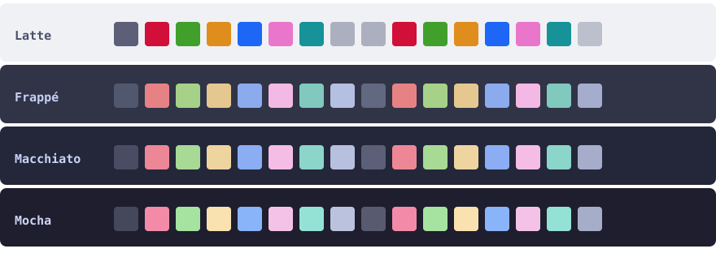

<h1 align="center">Catppuccin for Xshell</h1>

<p align="center">
  Soothing pastel colour schemes for <a href="https://www.netsarang.com/en/xshell/">NetSarang Xshell</a><br/>
  Latte · Frappé · Macchiato · Mocha
</p>

<p align="center">
  <b>English</b> · <a href="README.zh-CN.md">简体中文</a>
</p>

---

Four ready-to-use Xshell colour schemes built from the official
[Catppuccin](https://github.com/catppuccin/catppuccin) palette. The 16 ANSI slots are taken from
Catppuccin's terminal mapping — the exact values shipped by
[Catppuccin for Windows Terminal](https://github.com/catppuccin/windows-terminal) — and it is the
same palette [Catppuccin for VS Code](https://github.com/catppuccin/vscode) puts in its integrated
terminal, so an Xshell session looks like your local terminal and your editor.

Catppuccin has **no official Xshell port** (there is no `catppuccin/xshell` repository, and the
250+ schemes in [netsarang/Xshell-ColorScheme](https://github.com/netsarang/Xshell-ColorScheme)
do not include it). This repository fills that gap.



## Flavours

| Flavour | Background | Foreground | Use it for |
| --- | --- | --- | --- |
| **Latte** | `#EFF1F5` | `#4C4F69` | light rooms, bright screens |
| **Frappé** | `#303446` | `#C6D0F5` | dim rooms |
| **Macchiato** | `#24273A` | `#CAD3F5` | the middle ground |
| **Mocha** | `#1E1E2E` | `#CDD6F4` | dark rooms, night work |

## Install

### Option A — script (recommended)

Download this repository (green **Code** button → **Download ZIP**, or clone your own fork), then
from the extracted folder:

```powershell
powershell -ExecutionPolicy Bypass -File .\install.ps1
```

The script finds every Xshell data folder under
`%USERPROFILE%\Documents\NetSarang Computer\<version>\Xshell\ColorScheme Files`
(including OneDrive-redirected `Documents`), copies the four `.scs` files into each of them, and
prints what it did.

```powershell
.\install.ps1 -Destination 'D:\backup\xshell-schemes'   # install somewhere specific
.\install.ps1 -Uninstall                                # remove the schemes again
```

Xshell must have been started at least once, otherwise the folder does not exist yet.

### Option B — copy the files by hand

Copy the four `Catppuccin *.scs` files into:

```
%USERPROFILE%\Documents\NetSarang Computer\<version>\Xshell\ColorScheme Files\
```

`<version>` is `8` for Xshell 8, `7` for Xshell 7, and so on. If more than one version folder
exists, copy into the one you actually launch. Note that this is **not** the installation folder
(`C:\Program Files (x86)\NetSarang\...` or wherever `Xshell.exe` lives) — Xshell keeps user colour
schemes in Documents, and an upgrade of the program will not touch them there.

### Option C — import from the GUI

`Tools → Color Schemes → Import…` and pick a `.scs` file. Useful if you keep your schemes
somewhere else.

## Apply

1. Restart Xshell (the scheme list is built at startup).
2. `Tools → Color Schemes` (*工具 → 配色方案*), select **Catppuccin Mocha** (or another flavour) and confirm.
3. For a single session only: right-click the session → `Properties → Appearance → Color scheme`.

The name shown in the list is the file name, which is why the files keep the `Catppuccin ` prefix.

## Palette

Every Xshell scheme defines 16 ANSI slots plus a background and a foreground. Bold uses the
"bright" variants, exactly like Windows Terminal's `brightBlack` … `brightWhite`.

| ANSI | Role | Latte | Frappé | Macchiato | Mocha |
| --- | --- | --- | --- | --- | --- |
| 0 | black | `#5C5F77` | `#51576D` | `#494D64` | `#45475A` |
| 1 | red | `#D20F39` | `#E78284` | `#ED8796` | `#F38BA8` |
| 2 | green | `#40A02B` | `#A6D189` | `#A6DA95` | `#A6E3A1` |
| 3 | yellow | `#DF8E1D` | `#E5C890` | `#EED49F` | `#F9E2AF` |
| 4 | blue | `#1E66F5` | `#8CAAEE` | `#8AADF4` | `#89B4FA` |
| 5 | magenta | `#EA76CB` | `#F4B8E4` | `#F5BDE6` | `#F5C2E7` |
| 6 | cyan | `#179299` | `#81C8BE` | `#8BD5CA` | `#94E2D5` |
| 7 | white | `#ACB0BE` | `#B5BFE2` | `#B8C0E0` | `#BAC2DE` |
| 8 | bright black | `#ACB0BE` | `#626880` | `#5B6078` | `#585B70` |
| 9–14 | bright red … bright cyan | same as 1–6 | same as 1–6 | same as 1–6 | same as 1–6 |
| 15 | bright white | `#BCC0CC` | `#A5ADCE` | `#A5ADCB` | `#A6ADC8` |

The foreground (`text`) is Latte `#4C4F69`, Frappé `#C6D0F5`, Macchiato `#CAD3F5`,
Mocha `#CDD6F4`.

## What is inside the file

Each `.scs` is a tiny INI file with exactly 19 keys — no more, no less:

```ini
[Color Scheme]
background=1e1e2e
text=cdd6f4
text(bold)=cdd6f4
black=45475a
black(bold)=585b70
red=f38ba8
red(bold)=f38ba8
...
white=bac2de
white(bold)=a6adc8
```

Two details matter if you edit them:

- **Encoding is UTF-16 LE with a BOM and CRLF line endings.** That is what Xshell 8's own schemes
  use; a file saved as UTF-8 shows up garbled or is rejected. Every file here is exactly 676 bytes.
- **No cursor, selection or tab colours.** The format has no keys for them; Xshell controls those
  separately in the session properties.

### Known behaviour (not bugs)

- **ANSI 1–6 and their bright variants are identical.** Catppuccin maps `brightRed` to the same hex
  as `red`, so bold red is bold, not brighter.
- **On the dark flavours `brightWhite` is darker than `white`.** The bright slots follow the
  palette's Overlay/Subtext ordering rather than "brighter".
- **Latte's `white` is the same colour as `brightBlack` (`#ACB0BE`)** — 1.91:1 against `#EFF1F5`.
  ANSI white text is therefore deliberately faint; override that single key if a TUI uses white
  for body text.
- **Contrast is low by design.** The pastel accents sit around 2–3:1 on their own background
  (Latte's yellow is 2.31:1, Mocha's bright black 2.46:1). These are the upstream values, not a
  conversion mistake.

## Make your own flavour

Copy a file, edit the hex values (lower-case, no `#`), keep the 19 keys, and re-save it as UTF-16:

```powershell
$path = '.\Catppuccin Mocha.scs'
$text = Get-Content -LiteralPath $path -Raw
[System.IO.File]::WriteAllText($path, $text, (New-Object System.Text.UnicodeEncoding($false, $true)))
```

Hex values for every Catppuccin colour live in the
[palette table](https://github.com/catppuccin/catppuccin#-palette). Anything you add to
`ColorScheme Files` appears in the list after a restart.

## Troubleshooting

| Symptom | Fix |
| --- | --- |
| Scheme missing from the list | Copied into the wrong folder (the program folder instead of Documents), wrong `<version>`, or Xshell was not restarted. |
| Garbled name / scheme rejected | File was saved as UTF-8. Re-save as UTF-16 LE with BOM. |
| Bold text looks washed out | By design: bold maps to the bright slots, which Catppuccin keeps close to the normal ones. Edit the `*(bold)` keys if you want more separation. |
| TUI apps look 256-colour | Xshell's true-colour mode is off (`TrueColorTerminal=1` in `Xshell.ini`, or the matching session option). |
| Only one session should change | Set the scheme in that session's properties instead of the global list. |

## Compatibility

Tested with **Xshell 8.0.0099** on Windows 11. The `.scs` format is what Xshell 8 ships; some
older builds and most community packs use `.xcs` instead, which is a different layout (the scheme
name is the section header, plus a `[Names]` block). If your Xshell only accepts `.xcs`, rename
the section and append the names block:

```ini
[Catppuccin Mocha]
; ...the same 19 keys...
[Names]
count=1
name0=Catppuccin Mocha
```

## Credits

- Palette: [Catppuccin Org](https://github.com/catppuccin/catppuccin), MIT — the required
  copyright and permission notice is reproduced in [LICENSE-Catppuccin](LICENSE-Catppuccin).
- Slot mapping follows [catppuccin/windows-terminal](https://github.com/catppuccin/windows-terminal);
  the palette is shared with [catppuccin/vscode](https://github.com/catppuccin/vscode).
- This is an unofficial port, not affiliated with Catppuccin or NetSarang. The Catppuccin name and
  logo belong to the Catppuccin Org; the name is used here only to say what is being ported, and no
  logo is bundled.

MIT licensed — see [LICENSE](LICENSE).
