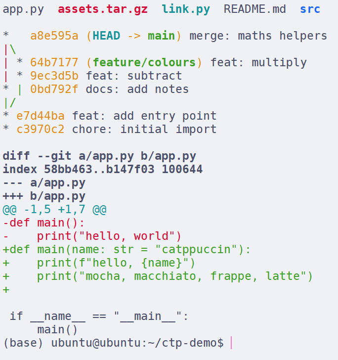
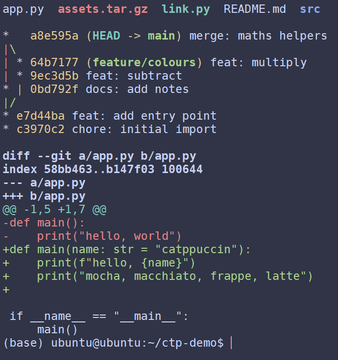
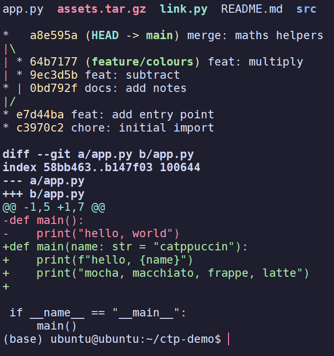

# Catppuccin for Xshell

<p align="center">
  <b>English</b> · <a href="README.zh-CN.md">简体中文</a>
</p>

Catppuccin in four flavours for NetSarang Xshell — Latte, Frappé, Macchiato and Mocha.

| Latte | Frappé |
|:--:|:--:|
|  |  |

| Macchiato | Mocha |
|:--:|:--:|
|  |  |

## 1. Grab the files

Hit the green **Code** button → **Download ZIP**, or just `git clone` it. Unzip or clone it wherever
you like.

## 2. Import them

Open Xshell, go to `Tools → Color Schemes…`, click **Import** and pick
`Catppuccin Mocha.scs`.

Want all four? Import the other three the same way, one file at a time.

## 3. Pick one

Still in that window — select a scheme, hit OK.

Only want it for a single session? Right-click the session →
`Properties → Appearance → Color scheme`.

## 4. Want the bright half too? (optional)

Xshell introduces itself to the server as a plain `xterm`, and in terminfo that means 8 colours. The
scheme still draws all 16 slots, but programs like `ls`, `git` and `vim` obey terminfo and never ask
for slots 8–15, so the brighter half just sits unused.

Add three lines to `~/.bashrc` **on the server**:

```bash
case "$TERM" in
  xterm) export TERM=xterm-256color ;;
esac
```

Reconnect; `tput colors` should say 256.

Skip it and everything still works — you just keep the bright slots idle. Since slots 9–14 are the
same hex as 1–6, the real difference is mostly `black`/`brightBlack` and `white`/`brightWhite`.

---

Palette tables, troubleshooting and compatibility notes live in [docs/details.md](docs/details.md).
