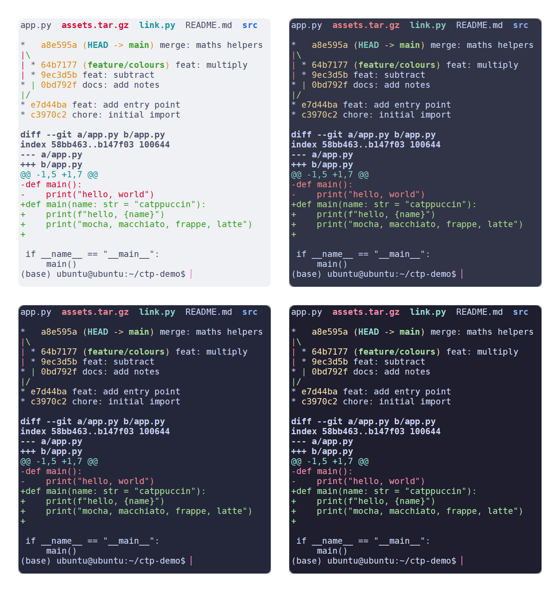
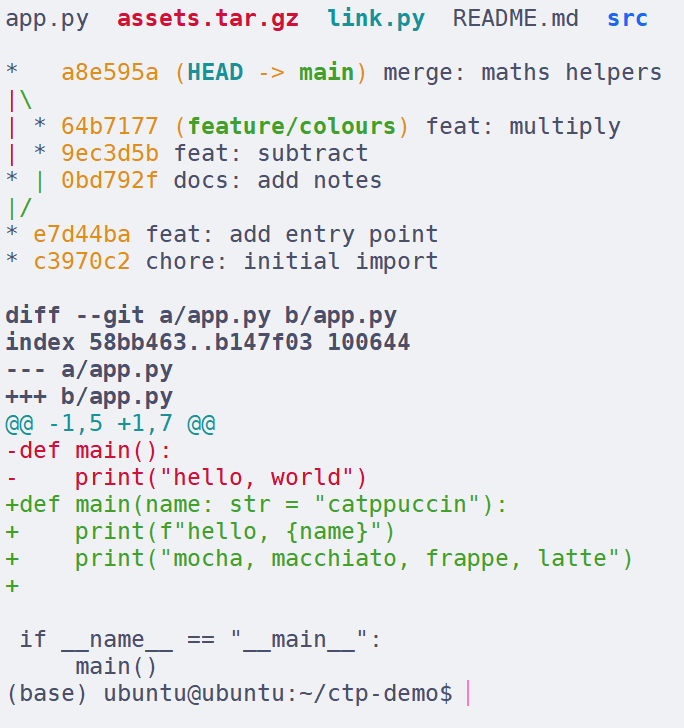
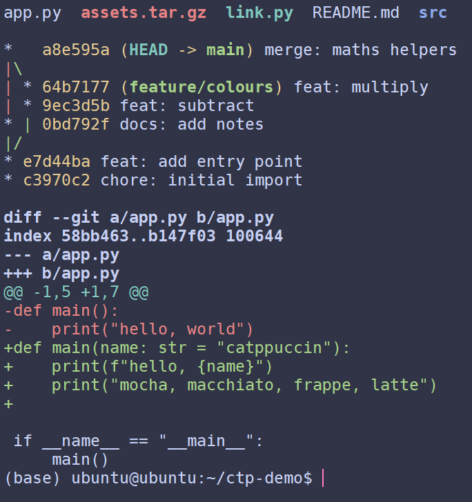
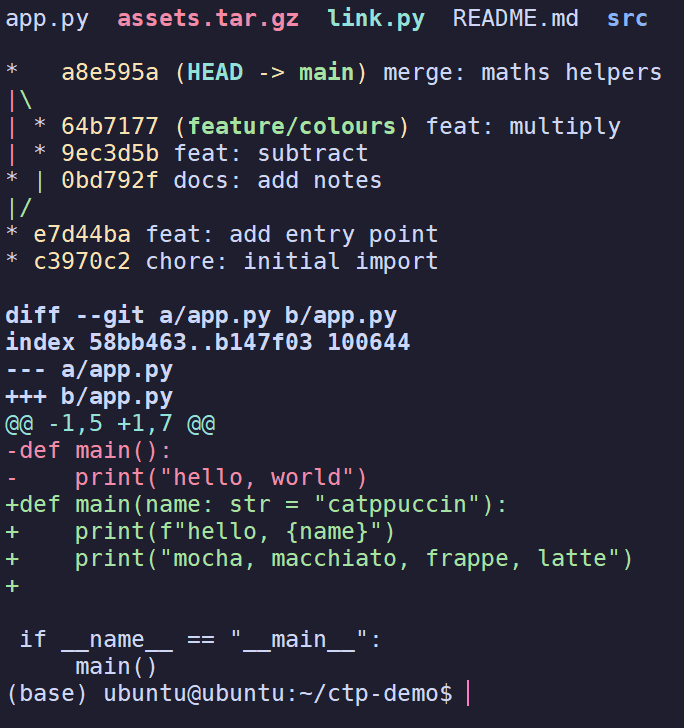

<h3 align="center">
	 
	
	Catppuccin for <a href="https://www.netsarang.com/en/xshell/">Xshell</a>
	
</h3>

	
	
	

	

	<a href="README.md">English</a>

## Previews

🌻 Latte

🪴 Frappé

🌺 Macchiato

🌿 Mocha

## 用法

1. 下载你想要的 flavour。
2. 打开 Xshell，进 **工具** → **配色方案…**
3. 点 **导入**，选中下载好的 `.scs` 文件。
4. 在列表里选中它，确定。

## 🙋 常见问题

- Q: **_“颜色是对的，但有一半从来不出来。”_**\
  A: Xshell 跟服务器报的是 `xterm`，对方会当成 8 色终端。改 `~/.bashrc` 三行即可，见
  [docs/details.zh-CN.md](docs/details.zh-CN.md)。
- Q: **_“导入之后列表里没有。”_**\
  A: 重启 Xshell。其它坑见 [docs/details.zh-CN.md](docs/details.zh-CN.md)。

## 💝 Thanks to

- [Your Name](https://github.com/YOUR_USERNAME)

&nbsp;

	

	Copyright &copy; 2026 <a href="https://github.com/YOUR_USERNAME" target="_blank">YOUR_USERNAME</a>

	

